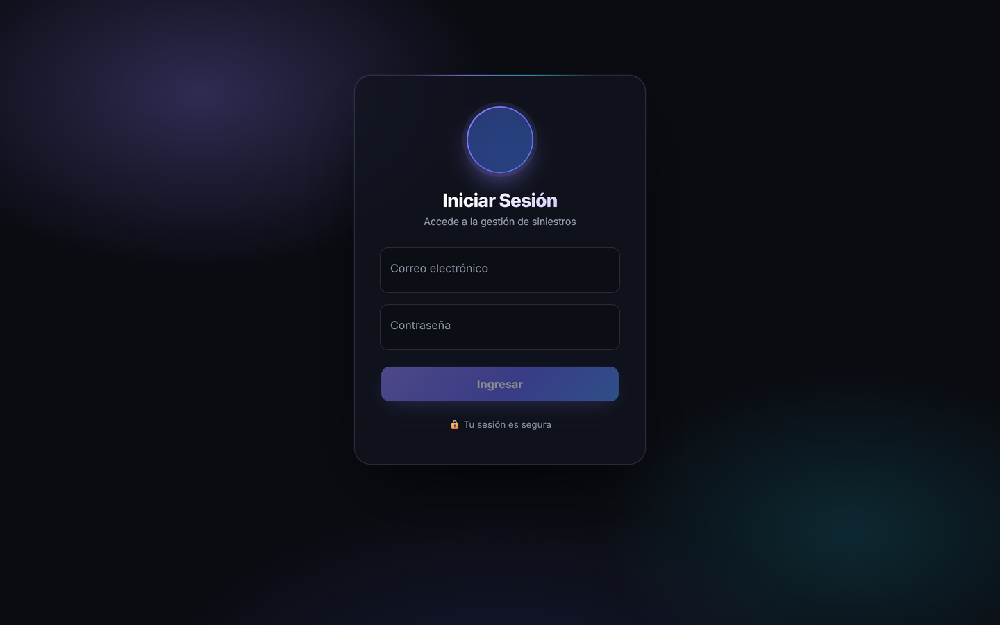
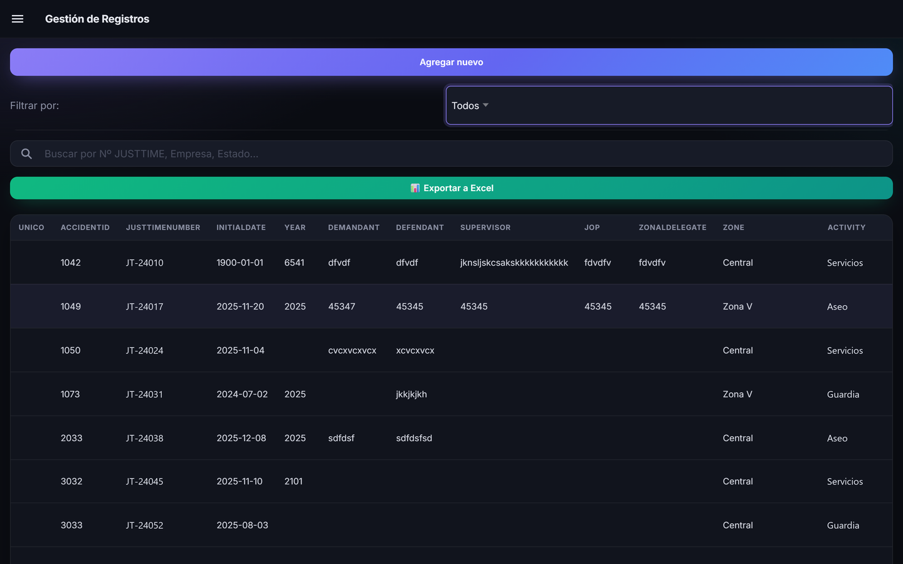
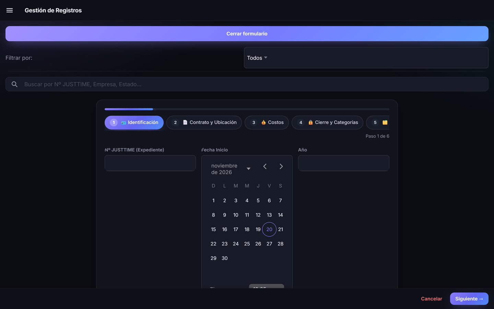
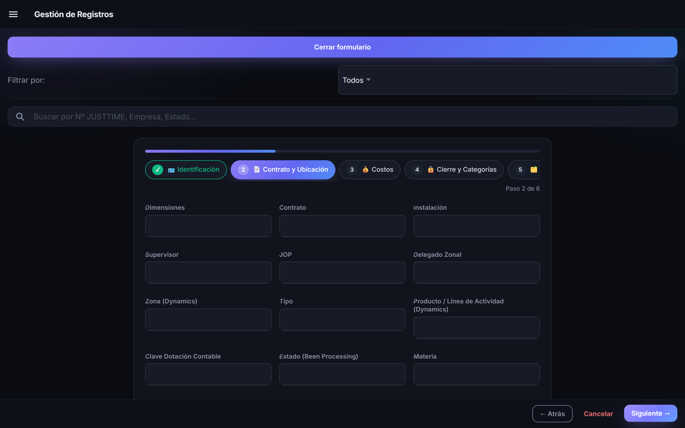
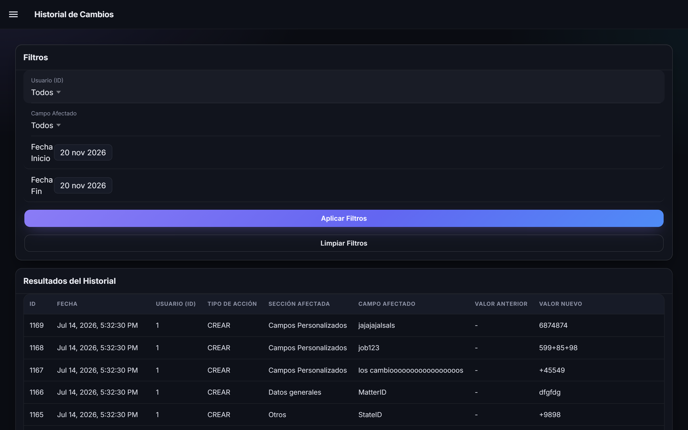
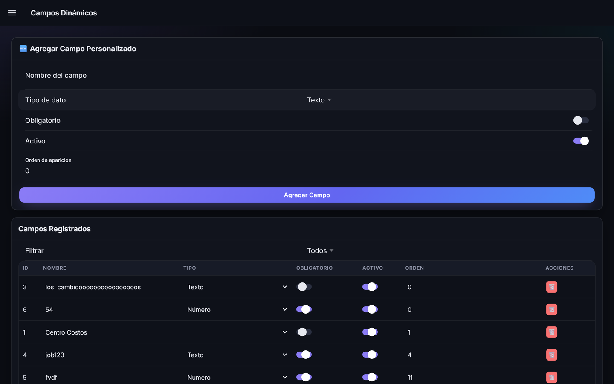
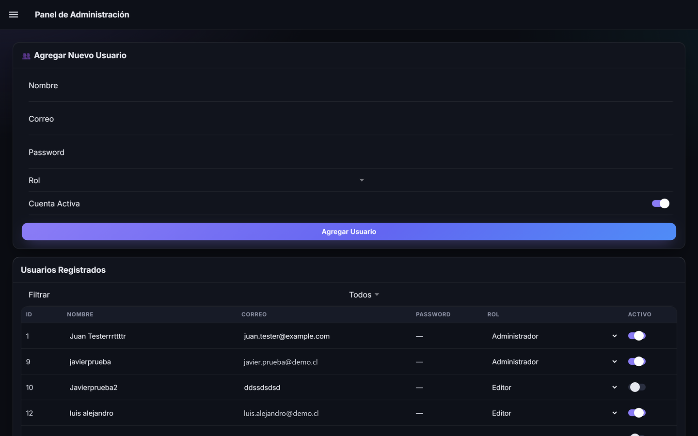
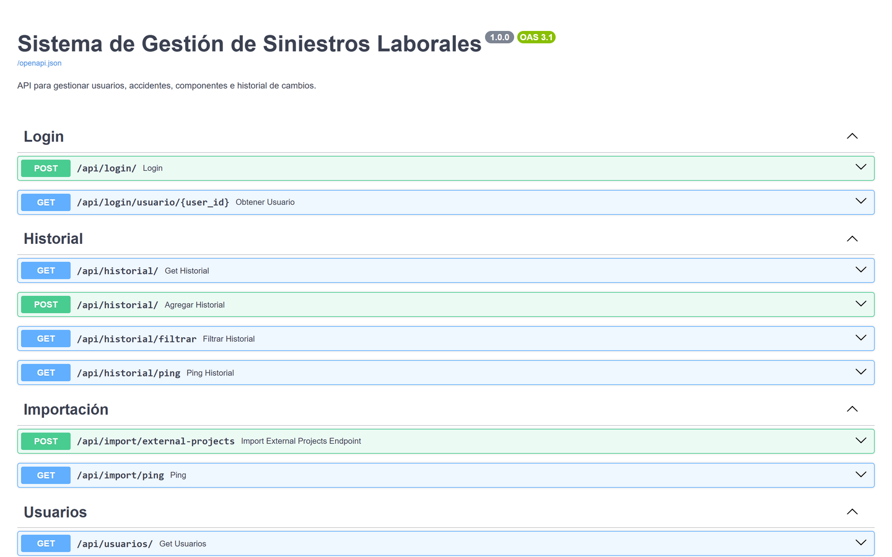

# Gestión de Siniestros

Sistema interno para el registro, seguimiento y auditoría de siniestros laborales: alta de accidentes, gestión de usuarios por rol, historial de cambios y campos personalizables.

## Qué problema resuelve

El seguimiento de siniestros laborales (accidentes, sus datos de contrato, ubicación, costos y estado) se llevaba de forma manual/dispersa. Este sistema centraliza esa información en una base de datos única, con:

- Control de quién puede ver o modificar qué (roles: Administrador, Editor, Visualizador).
- Registro automático de cada cambio realizado sobre un siniestro (quién, qué campo, valor anterior/nuevo, cuándo), para auditoría.
- Campos de formulario configurables sin tocar código (modelo EAV: se pueden agregar campos nuevos a los siniestros desde la propia aplicación).
- Importación de proyectos/contratos desde un sistema externo (Dynamics) para no tener que cargarlos a mano.

## Cómo lo resuelve

- **Backend** (FastAPI + SQLAlchemy sobre SQL Server): expone una API REST que centraliza toda la lógica de negocio, valida datos con Pydantic y deja un log de auditoría en cada escritura sobre un siniestro.
- **Frontend** (Angular + Ionic): aplicación web/móvil (vía Capacitor) que consume esa API, con guards de ruta según el rol del usuario logueado.
- **Historial diferencial**: al editar un siniestro, el backend compara campo por campo el valor anterior contra el nuevo y solo registra los que efectivamente cambiaron.
- **Campos dinámicos (EAV)**: además de los campos fijos del siniestro, se pueden definir campos adicionales desde la sección de administración, que se guardan y consultan sin necesidad de migrar la base de datos por cada campo nuevo.

## Capturas

| Login | Gestión de registros |
|---|---|
|  |  |
| **Alta de siniestro (paso 1)** | **Alta de siniestro (paso 2: contrato)** |
|  |  |
| **Historial de cambios** | **Campos dinámicos** |
|  |  |
| **Administración de usuarios** | **API (Swagger)** |
|  |  |

## Estado del proyecto

Este es un proyecto en desarrollo activo, no una pieza terminada. La siguiente tabla es una foto honesta de en qué estado está cada módulo, no una lista de logros.

| Módulo | Estado | Notas |
|---|---|---|
| Login (backend) | ✅ Completo | Valida contraseña con bcrypt contra el hash guardado y devuelve un JWT. |
| Autenticación por token (JWT) | ✅ Completo | El login devuelve un token firmado; todas las rutas protegidas lo exigen vía `Depends(get_current_user)` / `require_roles(...)` (`app/utils/security.py`). El frontend lo guarda en `localStorage` y lo manda en cada request. |
| Gestión de usuarios (CRUD) | ✅ Completo | Alta, edición, listado. Solo accesible para rol Administrador (verificado también en el backend, no solo en el frontend). |
| Registro de siniestros (alta/edición/baja) | ✅ Completo | Incluye wizard por pasos en el frontend. |
| Historial de cambios / auditoría | ✅ Completo | Registro diferencial automático + filtros por usuario, campo y rango de fechas. El historial de un siniestro ya no se borra en cascada al eliminarlo (bug corregido, ver commits). |
| Campos dinámicos (EAV) | ✅ Completo | Alta/baja de campos personalizados y su persistencia junto a los siniestros. Lectura para cualquier rol autenticado, escritura solo Administrador. |
| Importación desde Dynamics | 🟡 Parcial | El endpoint de importación existe y funciona; la validación de un proyecto contra Dynamics (`GET /validar_dynamics`) depende de un servicio externo cuya disponibilidad no está garantizada ni testeada acá. |
| Roles y permisos | ✅ Completo | Verificados tanto en el frontend (`RoleGuard`, UX) como en el backend (`require_roles`, seguridad real). |
| Tests automatizados | 🟡 Parcial | Backend: tests unitarios con pytest para los dos servicios con más lógica (`tabla_service`, `gestion_historial_service`), corriendo contra SQLite en memoria. Frontend: solo quedan los stubs `should create` que genera Angular CLI por defecto, sin cobertura real. |
| CI/CD | 🟡 Parcial | GitHub Actions (`.github/workflows/ci.yml`) corre los tests del backend y el build de producción del frontend en cada push/PR a `main`. No corre lint (43 errores de estilo preexistentes, no relacionados con seguridad) ni los tests de Angular (requieren Chrome headless, no configurado). |
| Build de producción documentado | ✅ Completo | `environment.prod.ts` tiene la misma forma que `environment.ts`; falta reemplazar la URL placeholder por la real antes de un deploy. `ng build --configuration production` corre limpio. |

**Leyenda:** ✅ Completo · 🟡 En progreso / parcial · ❌ Pendiente

## Seguridad y limitaciones conocidas

- El login ya no tiene ningún mecanismo de bypass: la única forma de autenticarse es con la contraseña real verificada contra el hash bcrypt.
- Todas las rutas de la API (excepto `POST /login/`) exigen un JWT válido en el header `Authorization: Bearer <token>`, verificado server-side en cada request — no solo del lado del frontend.
- El `user_id` para el log de auditoría se toma en todos los casos del JWT verificado (`TablaService` y `POST /historial/`), nunca de un valor que mande el cliente sin validar.
- Se sacó el `cascade="all, delete-orphan"` de la relación `Accident.log` para que el historial sobreviva al borrado de un siniestro. Esto se verificó contra SQLite (sin foreign keys estrictas). **No se pudo verificar contra el esquema real de SQL Server en producción** — si esa base tiene la foreign key configurada en modo estricto (sin `ON DELETE CASCADE`/`SET NULL`), borrar un siniestro con historial existente podría fallar por violación de integridad referencial en vez de simplemente conservar el log. Conviene revisarlo contra la base real antes de confiar en este comportamiento.
- CORS está configurado para aceptar cualquier origen (`allow_origins=["*"]`) — pensado para desarrollo, hay que restringirlo antes de exponer el backend fuera de una red controlada.

## Stack técnico

**Backend**
- Python 3.11+, FastAPI, SQLAlchemy 2.x
- SQL Server (vía ODBC / `pyodbc`)
- Autenticación de contraseñas con `bcrypt` / `passlib`
- Pydantic v2 para validación y configuración por entorno

**Frontend**
- Angular 17+ con Ionic (componentes standalone)
- Capacitor (para empaquetar como app móvil)
- RxJS para manejo de estado reactivo de sesión

## Estructura del repositorio

```
gestion-siniestros/
├── backend/     # API FastAPI
└── frontend/    # App Angular/Ionic
```

## Variables de entorno (backend)

Ver `backend/.env.example` para la lista completa. Ninguna variable tiene un valor real por defecto en el código: si `.env` no está presente o incompleto, el backend no va a poder conectarse a la base de datos.
